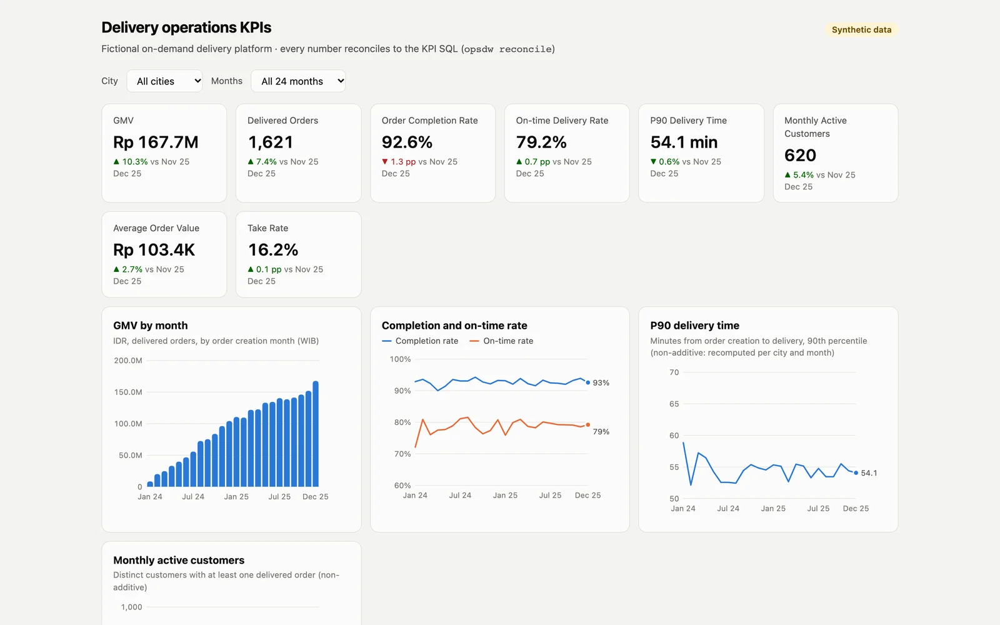
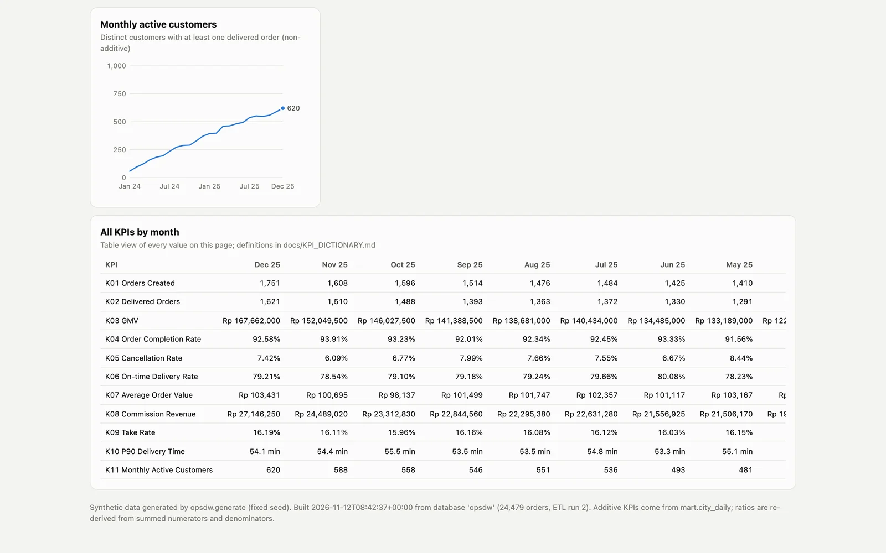

# OpsDW — Operational Analytics Engineering, a verifiable vertical slice

A small but complete warehouse for a **fictional** on-demand delivery platform, built to show
advanced SQL and analytical data modelling end to end: landing files → raw → staging → star schema
→ mart → Power BI-ready semantic layer → dashboard, with incremental ETL, data-quality gates,
measured query performance and an automated KPI reconciliation.

> **All data is synthetic** (seeded generator, see [`docs/DATA_SOURCE.md`](docs/DATA_SOURCE.md)).
> No number here is a business result of any real company. Numbers exist to prove the engineering
> and are reproducible bit-for-bit from the commands below.

## What it does, and how

The problem: SQL, a BI model and a dashboard can each report a *different* number for the same KPI. OpsDW builds the
warehouse behind a delivery platform and then **proves that SQL, the BI model's measure logic and the dashboard all
report the same number**, cell by cell (the DAX measures are checked through their SQL translation on the `bi.*` views;
the DAX itself is not run here).

<table>
<tr>
<td width="50%"><br><sub><b>KPI dashboard</b> (dev dataset, 24,479 orders). Eight headline tiles and trend charts with city and month filters; all eleven KPIs are in the table view. Every value is checked against the canonical KPI SQL.</sub></td>
<td width="50%"><br><sub><b>Table view.</b> Every value on the page as a table, with definitions in <code>docs/KPI_DICTIONARY.md</code>.</sub></td>
</tr>
</table>

| Feature | What it does | How it works |
|---|---|---|
| **Synthetic source with known defects** | Generates three source feeds with duplicates, late and corrupt rows, so every check has a known right answer. | A seeded generator logs every defect it injects; tests compare the warehouse against that log. |
| **Incremental, idempotent ETL** | Loads only new or changed rows, including late and out-of-order ones. | A watermark on the raw ingest id and a `MERGE`; the merge and the new watermark commit in one transaction, so a crash rolls back cleanly. 53 incremental runs equal one full rebuild. |
| **Star schema with history** | Keeps history where it changes money: a merchant's commission tier is the one valid when the order was placed. | Conformed dimensions, a type-2 slowly changing dimension, an accumulating snapshot, and a monthly-partitioned transaction fact. |
| **Data-quality gate** | Stops the pipeline when the data is wrong. | 43 checks: uniqueness, not-null, referential integrity, accepted values, business rules, history integrity, freshness, and row and sum reconciliation between layers. Ten sabotage tests break the data on purpose and the gate must fail each time. |
| **One definition per KPI** | Eleven KPIs, each with its question, numerator, denominator, grain, filters and caveats. | Defined once in `kpis/kpis.yml`, then computed by the canonical SQL, a Power BI-ready model (DAX checked via its SQL translation) and the dashboard. |
| **Reconciliation** | Shows the three places agree. | A command compares every month and city cell: 1,848 cells, 0 mismatches. Tests confirm the check catches a wrong roll-up, such as averaging city percentiles. |
| **18 analytical queries** | Cohorts, funnel, retention, rolling windows, percentiles, RFM, Pareto, SCD2 point-in-time. | Each query is tested against a hand-derived expected result ([docs/ANALYTICS_QUERIES.md](docs/ANALYTICS_QUERIES.md)). |
| **Measured performance** | Shows what each index or partition buys. | `EXPLAIN (ANALYZE, BUFFERS)` before and after on 800,100 orders, median of seven runs ([docs/perf/RESULTS.md](docs/perf/RESULTS.md)). It also exposed a load step that turned quadratic at that volume, now rewritten as joins. |

## What is in the box

| Deliverable | Where | Status |
|---|---|---|
| PostgreSQL 18 warehouse in Docker Compose (host port **55462**) | `docker-compose.yml`, `sql/ddl/` | implemented, tested |
| Deterministic synthetic source with documented injected defects | `src/opsdw/generate.py`, `docs/DATA_SOURCE.md` | implemented, tested against its own ground-truth manifest |
| Raw → staging → core star schema (conformed dims, SCD1, **SCD2**, accumulating snapshot, partitioned transaction fact) → additive mart | `sql/transform/`, `docs/ARCHITECTURE.md` | implemented, tested |
| Incremental, idempotent ETL (watermark on raw ingest id, MERGE, late / out-of-order / early-arriving data, crash rollback) | `src/opsdw/transform.py` | implemented, tested (16 tests) |
| Data-quality gate: uniqueness, not-null, referential integrity, accepted values, business rules, SCD2 integrity, freshness, layer-to-layer row-count / sum reconciliation | `dq/checks.yml`, `opsdw dq` | implemented, tested incl. 10 sabotage tests that must make it exit 1 |
| 18 analytical queries (cohorts, funnel, retention, rolling windows, gaps-and-islands, percentiles, YoY/MoM, RFM, Pareto, GROUPING SETS, SCD2 point-in-time) | `sql/analytics/`, [`docs/ANALYTICS_QUERIES.md`](docs/ANALYTICS_QUERIES.md) | implemented, each with a hand-derived expected-result test |
| Query performance with `EXPLAIN (ANALYZE, BUFFERS)` before/after on a documented volume | `src/opsdw/bench.py`, [`docs/perf/RESULTS.md`](docs/perf/RESULTS.md) | measured (numbers below) |
| KPI dictionary (question, numerator, denominator, grain, window, filters, owner, caveats) | `kpis/kpis.yml` → [`docs/KPI_DICTIONARY.md`](docs/KPI_DICTIONARY.md) | implemented |
| Power BI-ready semantic model: star views, relationships, DAX measures | `sql/semantic/bi_views.sql`, [`powerbi/`](powerbi/MODEL.md) | implemented; **DAX not executed (no Power BI on macOS)** |
| Reconciliation sheet: canonical SQL = DAX-equivalent SQL on the BI views = dashboard, per month × city | `opsdw reconcile`, [`docs/RECONCILIATION.md`](docs/RECONCILIATION.md) | implemented, tested (incl. tests that it catches wrong roll-ups) |
| Lightweight dashboard (static HTML, data embedded, city/month filters, table view, light/dark) | `dashboard/`, `opsdw dashboard` | implemented, checked in a browser |
| `.pbix` / `.pbip` Power BI file | — | **not done** (see Limitations) |

Terms used above: **SCD2** keeps every past version of a row with its valid-from and valid-to dates; the
**watermark** is the last raw ingest id already loaded; an **accumulating snapshot** has one row per order, updated as
the order moves through its stages. Details in [`docs/ARCHITECTURE.md`](docs/ARCHITECTURE.md).

## Quick start

Prerequisites: Docker (Colima works; the standalone `docker-compose` binary or `docker compose`),
[`uv`](https://docs.astral.sh/uv/). Python 3.12 is pinned in `.python-version`.

```bash
./scripts/ci.sh
```

That single script starts PostgreSQL, generates the dev dataset (seed 42), rebuilds the database,
ingests, transforms, checks that a re-run is a no-op, runs the data-quality gate, the KPI
reconciliation and the full test suite. It exits non-zero on the first failure.

Step by step (dev scale, database `opsdw`):

```bash
docker-compose up -d --wait
```

```bash
uv run opsdw generate --scale dev --seed 42
```

```bash
uv run opsdw init --recreate && uv run opsdw ingest --scale dev && uv run opsdw transform -v
```

```bash
uv run opsdw dq
```

```bash
uv run opsdw reconcile
```

```bash
open dashboard/dist/index.html
```

Run any analytical query directly, e.g. cohort retention:

```bash
psql "host=127.0.0.1 port=55462 user=opsdw password=opsdw_local_only dbname=opsdw" -f sql/analytics/q04_cohort_retention.sql
```

## Headline results (committed run, 2026-11-12, `make bench`)

Documented volume: `--scale bench --seed 42` → 800,100 orders, 3,583,406 unique order events,
4,507,273 raw landed rows (4,401,394 initial + 105,879 incremental; incl. injected duplicates/corruptions)
over 2024-01-01..2025-12-31.
Machine: Colima VM, 4 vCPU / 5.8 GiB, Apple M4, PostgreSQL 18.6. Synthetic data.

| Check | Result |
|---|---|
| Data-quality gate on bench data | 43 checks: 42 pass, 1 expected warning (680 events of the 153 orders whose header only ever arrived corrupted), 0 fail |
| Pipeline vs generator ground truth (bench) | 799,947 fact orders = 800,100 − 153 corrupt-only; 3,857 merchant SCD2 rows = 3,000 + 856 tier changes + 1 unknown member |
| KPI reconciliation (11 KPIs × 24 months × 6 cities + ALL) | 1,848 cells, **0 mismatches** between canonical SQL, DAX-equivalent SQL on `bi.*`, and the built dashboard |
| Initial load | first 721 daily batches, 4.40M of the 4.51M raw rows (the remaining ~106k arrive in the incremental runs below): ingest 22.9 s, transform 93.3 s (single transaction); full refresh 92.5 s |
| Daily incremental run | ~10.5k raw rows/day → 2.0–3.5 s transform, 2.5–4k orders recomputed; no-op re-run 0.09 s |

| Benchmark (median of 7, warm cache) | Before | After | Design |
|---|---:|---:|---|
| B1 one month by city | 21.6 ms | 11.3 ms | B-tree on `created_date_key` (low selectivity → only 1.9×) |
| B2 customer's latest 20 orders | 23.0 ms | 0.02 ms | composite `(customer_key, created_at)` |
| B3 hourly delivered events, 7 days | 44.8 ms | 1.7 ms | monthly partitions (pruning) + `(event_type, event_at)` |
| B4 one courier's active days, 1 quarter | 48.4 ms | 0.33 ms | partial index (no pruning: filter isn't on the partition key) |
| B5 24-month dashboard trend | 75.9 ms | 1.1 ms | additive periodic-snapshot mart |

Full method, plans, index sizes and caveats: [`docs/perf/RESULTS.md`](docs/perf/RESULTS.md).
A scale bug found only at this volume (quadratic `IN (subquery)` in the event load) is written up in
[`docs/ARCHITECTURE.md`](docs/ARCHITECTURE.md#found-at-bench-volume-not-at-dev-volume).

## How to reproduce every number

| Number / artifact | Command | Database |
|---|---|---|
| Expected results of the 18 queries (fixture) | `uv run pytest tests/test_analytics_queries.py` | `opsdw_fixture` (created by the test) |
| ETL behaviour (equivalence, idempotency, late data, rollback) | `uv run pytest tests/test_etl_incremental.py` | `opsdw_test` |
| DQ gate pass + sabotage failures | `uv run pytest tests/test_data_quality.py` and `uv run opsdw dq` | `opsdw_test` / `opsdw` |
| `docs/perf/RESULTS.md`, `docs/perf/plans/*`, `docs/RECONCILIATION.md`, `docs/reconciliation.csv`, headline table above | `make bench` (≈ 5 min) | `opsdw_bench` |
| `docs/KPI_DICTIONARY.md`, `docs/ANALYTICS_QUERIES.md` | `uv run opsdw docs` | — |
| Dataset volumes in `docs/DATA_SOURCE.md` | `uv run opsdw generate --scale bench --seed 42 --force` → `manifest.json` | — |

Generated files are deterministic except timings and timestamps.

## Architecture in one paragraph

Landing CSVs are loaded append-only into `raw.*` (all TEXT, sha256-tracked, so re-ingesting is a
no-op and a changed file is an error). One transform transaction takes the delta
`_ingest_id ∈ (watermark, max]` per source, validates and deduplicates into `staging.*`
(bad rows go to `staging.rejected_rows` with a reason), propagates the set of changed keys into
SCD1/SCD2 dimensions, the order-event transaction fact (monthly partitions) and the order
accumulating snapshot, refreshes only the affected days of the additive mart, and advances the
watermarks in the same commit. Details and design rationale: [`docs/ARCHITECTURE.md`](docs/ARCHITECTURE.md).

## Testing summary

`uv run pytest` — 54 tests in four files:

- `test_etl_incremental.py`: 53 incremental runs ≡ one full refresh (fingerprint of every table in
  natural keys); pipeline output equals the generator's injected-defect manifest; no-op re-run;
  file re-ingest skipped; changed file and schema drift rejected; crash mid-run rolls back and the
  retry succeeds; late delivery event updates fact and mart; stale order version ignored; inferred
  customer keeps its key; late back-dated SCD2 version re-keys facts; unknown merchant re-keyed;
  duplicates / noise / invalid rows; `NaN` / `infinity` / `now` / out-of-range dates quarantined;
  equal-`updated_at` versions resolve the same way incrementally and on rebuild; a second concurrent
  ingester is refused.
- `test_analytics_queries.py`: every query in `sql/analytics/` against hand-derived results.
- `test_data_quality.py`: clean data passes; each sabotage (duplicate across partitions, broken FK,
  wrong GMV, wrong SCD2 commission, missing fact row, mart drift, stale source, un-processed raw
  rows, SCD2 gap, milestone order) makes `opsdw dq` return 1.
- `test_reconciliation.py`: all KPIs reconcile on the fixture; hand-checked KPI values; a dashboard
  that averages city P90s or drops a city is caught.

## Independent review

After the build, a separate review pass (a fresh Claude Code review agent that got the code and a short brief, not the
build conversation or its conclusions) read the code cold and checked suspicions with read-only queries.
Fixed as a result: `pg_input_is_valid()` accepted `'NaN'` amounts and `'infinity'`/`'now'`/`'epoch'` timestamps (would poison GMV or abort
every run) → strict validators; versions with equal `updated_at` resolved differently
incrementally vs on rebuild → `(updated_at, _ingest_id)` tie-break; the watermark assumed one
ingester → now enforced by an advisory lock; a wrong take-rate caveat; NTILE splitting tied
customers in RFM → `cume_dist` scoring; an inner join that could drop a late merchant in Q09.
Each fix has a regression test. Remaining known DAX nuances are listed in `powerbi/MODEL.md`.

## About this repository

Built as a portfolio project. Case study with the reasoning and the limits: <https://dzahyk.github.io/case-opsdw.html>.

### Contributors

| Contributor | Role | Responsibility |
|---|---|---|
| **Daffa Zahy Khairy** ([@dzahyk](https://github.com/dzahyk)) | Author, data modeller, reviewer | The KPI definitions; the data model and SQL design; the data-quality rules; the expected results the tests check against, including the hand-derived answers for the 18 queries; reviewing and verifying every result. |
| **Claude** (Anthropic), used through Claude Code | Implementation and review assistant | Writing the implementation to the specifications and expected results I defined, and drafting tests for my review; a separate review pass on the finished code (see Independent review). It decides nothing about definitions, rules or what counts as correct. |

**How AI is used here.** AI speeds up the typing so that my effort goes to the parts that decide whether the numbers can
be trusted: what each KPI means, what the data model must preserve, and what a correct answer is. The expected values come
from me, not from the assistant, and the 43 checks, 54 tests and the 1,848-cell reconciliation decide whether a change is
accepted.

Every number in this README can be reproduced with the commands above; `scripts/ci.sh` (also run by GitHub Actions on
every push) rebuilds the dev warehouse from scratch and fails on the first broken check.

## Known limitations

- **No `.pbix`.** Power BI Desktop is Windows-only; the semantic model is delivered as views,
  documented relationships and DAX text. The DAX is not executed anywhere here; its SQL
  translation is. Syntax errors in the DAX would only surface when loaded into Power BI.
- **Synthetic data.** Distributions are invented; seasonality is simple (growth + weekend uplift);
  no refunds, promotions budget, multi-item baskets or courier pay. Don't read business meaning
  into the numbers.
- **Single node, local Docker.** Performance numbers come from one laptop (Colima VM, warm cache)
  and one run per `make bench`; they show the effect of the physical design, not production latency.
- **Orchestration is a CLI**, not Airflow/Dagster; scheduling, alerting and backfills by date
  range are out of scope. The DQ results are stored in `meta.dq_results` but nothing pages anyone.
- **Freshness** is checked against wall-clock time of ingestion (26 h). On a static dataset it
  passes only right after an ingest (which is what `scripts/ci.sh` does).
- **KPI attribution** is by order *creation* date in WIB; a delivery-date view would need a second
  date relationship (role-playing date dimension), not built.
- The dashboard is static HTML regenerated by a command, not a live BI tool.
